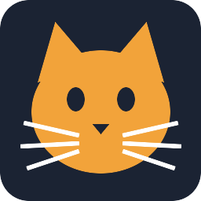

# Whiskers V5

A Rocket League bot for [RLBot v5](https://rlbot.org): a neural network trained from scratch by self-play
reinforcement learning (PPO). One policy plays 1v1, 2v2 and 3v3. It runs as a hivemind, so a single process drives
every Whiskers car on a team.

This repository holds one version of the bot, the one after **33.3 billion training steps**, with everything needed
to run it: the bot, its observation builder, the policy network and the weights. It contains no training code.

## What to expect

- **Strength.** Against the original Nexto in 1v1 this version scored 74 goals to 81 over 40 two-minute games, so
  it plays at about Nexto's level in that mode. It has not been measured against Nexto in 2v2 or 3v3.
- **Cost.** It runs on the CPU. The network's forward pass for three cars takes under a millisecond on one core of a
  desktop processor, and the bot decides 15 times a second.
- **Style.** Nothing is scripted except an optional kickoff. Everything else, including rotation and boost
  management, is what the network learned.

## Quick start

You need [Python 3.12](https://www.python.org/downloads/), Rocket League and RLBot v5.

**Windows**

1. Download this repository (green **Code** button, then **Download ZIP**) and unpack it, or `git clone` it.
2. Double-click `setup.bat`. It creates a virtual environment in `.venv`, installs the three dependencies (the
   CPU build of PyTorch is a download of about 200 MB) and runs a self-check that ends with a line starting `ok:`.
3. In the RLBot launcher, add `src/bot.toml` and put **Whiskers** in a match.

**Linux**

```bash
./setup.sh
```

then add `src/bot.toml` in the launcher as above.

**By hand** (any platform)

```bash
python -m venv .venv
.venv/bin/pip install -r requirements.txt        # Windows: .venv\Scripts\pip install -r requirements.txt
.venv/bin/python src/bot.py --selfcheck          # Windows: .venv\Scripts\python src\bot.py --selfcheck
```

`dev.toml` is a ready-made match with Whiskers on blue and a human on orange, for trying it out.

## Options

`src/bot.toml` starts the bot with `bot.py` and no arguments. To change its behaviour, add arguments to the
`run_command` there:

| Argument | Effect |
|---|---|
| *(none)* | plays the most likely action at every decision; this is the bot at its strongest |
| `--sample` | picks each action at random from the policy's distribution, as during training; weaker and more varied |
| `--temperature=T` | samples from a sharpened (`T` below 1) or flattened (`T` above 1) distribution |
| `--kickoff-script` | uses a scripted speed-flip kickoff instead of the bot's own |
| `--selfcheck` | loads the weights, scores one empty observation and exits, without RLBot |
| `MODEL_PATH` | weights file to load instead of `src/model.pt` |

## How it works

- **Decisions.** Every 8 game ticks (15 times a second) each car picks one of 90 discrete actions, a combination of
  throttle, steering, pitch, yaw, roll, jump, boost and handbrake, and holds it until the next decision.
- **Observation.** 462 numbers per car: its own state, the ball, a short prediction of the ball's path, the boost
  pads, and every other car on the pitch. The orange team sees the pitch rotated half a turn, so every car attacks
  the same way.
- **Network.** The other cars are read as an unordered set: each is passed through the same small encoder and the
  results are pooled (mean and maximum), team-mates and opponents separately, so the same weights work for any team size up to 3v3.
  The pooled result and the car's own inputs go through three fully connected layers (1024, 1024, 512 units).
  The policy has 2.8 million weights.
- **Training.** PPO with self-play, mostly against a league of the bot's own earlier versions, in the
  [RocketSim](https://github.com/ZealanL/RocketSim) simulator, on a single desktop PC.

## Bot pack build

The repository is laid out for the RLBot v5 bot pack's builder, [bob](https://github.com/swz-git/bob): `bob.toml`
points it at `bot.spec`, a PyInstaller spec that bundles `src/` with the weights and leaves PyTorch out, because the
pack ships one shared copy that `src/bot.py` falls back to. With bob and Docker installed: `bob build bob.toml`.

The PyInstaller spec has been built and run on its own. The full bob build has not been run yet, so treat it as
untested and open an issue if it fails.

## Layout

| Path | Contents |
|---|---|
| `src/bot.py` | the RLBot bot: reads packets, decides every 8 ticks, holds the controls in between |
| `src/bot.toml`, `src/loadout.toml`, `src/logo.png` | what the RLBot launcher reads |
| `src/whiskers/obs.py` | game state to observation |
| `src/whiskers/model.py` | the policy network |
| `src/whiskers/actions.py` | the table of 90 discrete actions |
| `src/whiskers/live.py` | RLBot packet to the bot's own game-state layout |
| `src/whiskers/kickoff.py`, `kickoffs.json` | the optional scripted kickoff |
| `src/model.pt` | the policy's weights (11 MB) |
| `setup.bat`, `setup.sh`, `requirements.txt` | installation |
| `dev.toml` | a development match: Whiskers against a human |
| `bob.toml`, `bot.spec` | bot pack build |

## Troubleshooting

- **The self-check does not print `ok:`.** Run it by hand (see *By hand* above) and read the error. The usual causes
  are a Python version other than the tested 3.12 or an interrupted PyTorch download; delete `.venv` and run the
  setup again.
- **The PyTorch install fails with a "No such file or directory" or long-path error (Windows).** The folder's path
  is too long. Unpack the repository somewhere short, for example `C:\RLBot\whiskers-v5-bot`, and run the setup
  again.
- **The launcher starts the bot and it exits at once.** The `run_command` in `src/bot.toml` expects the virtual
  environment at `.venv` in the repository's root. If yours is elsewhere, edit that line.
- **Anything else.** Open an issue with the bot's console output.

## License

MIT, see [LICENSE](LICENSE).
